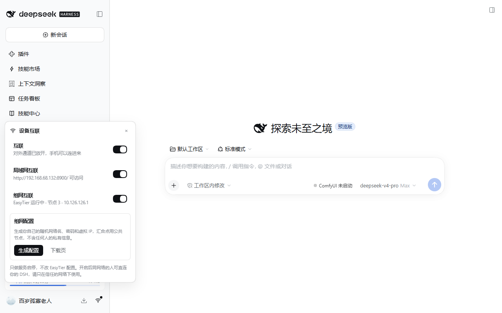

# dsh-device-link · 设备互联

把本机运行的 **DeepSeek Harness 桌面版** 一键开给别的设备访问 —— 用手机、平板、另一台电脑打开浏览器，就能用同一个 DSH。

左下角 **WiFi 图标** → 点开「设备互联」卡片 → 三个开关。



> 当前版本 `1.0.0`，仅支持 **Windows 10 / 11**。

---

## 它解决什么问题

DSH 桌面版把服务写在 `127.0.0.1` 上（还带浏览器会话校验），所以同一台机器以外的设备天然打不开。这个插件做两件事：

1. 在本机起一个**带鉴权注入的转发网关**，把外部请求转给 DSH，手机就能访问；
2. 顺手管 **EasyTier** 组网服务的启停，让不在同一 WiFi 的设备也能连进来。

它**不修改 DSH 本身**，也不修改 EasyTier 的任何配置，只做「开 / 关」。

## 三个开关

| 开关 | 作用 | 打开后 |
| --- | --- | --- |
| **互联** | 总闸 | = 局域网互联 + 组网互联一起打开 |
| **局域网互联** | 给同一 WiFi / 同一网段的设备开入口 | `http://<本机局域网IP>:8900/` |
| **组网互联** | 给经 EasyTier 组网的设备开入口，并启停 EasyTier 服务 | `http://<EasyTier 虚拟IP>:8899/` |

- 关掉开关 = 停网关进程（局域网互联）、或停网关 + 停 EasyTier 服务（组网互联）。
- 组网互联打开时，如果 EasyTier 服务在跑但虚拟网卡没拿到 IP（半死状态），会自动 **重启** 服务。
- 「关掉再打开」就等价于「重启组网」。

> 端口被别的程序占着时，局域网入口会自动往上顺延（默认最多顺延 5 个），实际端口显示在卡片里。

## 还没装 EasyTier？（组网互联的准备工作）

组网互联依赖 EasyTier。卡片「组网互联」下面会自动检测，并按情况给出按钮 —— **不装 EasyTier 也能正常用局域网互联**，只是组网那行会置灰。

| 卡片状态 | 你能点 |
| --- | --- |
| 没检测到 EasyTier | **用 winget 安装**（有 winget 时）/ **打开下载页**（GitHub Releases）/ **重新检测** |
| 装了但还没配置 | **生成配置**（生成一份属于你自己的 `easytier.toml`）/ 打开下载页 |
| 已经配置好 | 显示网络名称、虚拟 IP、配置路径；**显示/隐藏密码**、**复制邀请**、**注册服务 / 重装服务** |

几个要点：

- **生成的是你自己的凭据。** 网络名（`dsh-xxxxxx`）、网络密码（16 位随机）、虚拟网段都是当场随机生成的，每台设备各不相同；想两台设备组网，就把「复制邀请」里的内容发给对方，让对方填进自己生成的配置里（或统一改成同一份网络名 + 密码）。
- **包里只有公共汇合点。** 随包附带的是几个公开的社区中转节点（`meetPeers`），它们只负责让两台设备互相发现，握手成功后数据走 P2P 直连。**包里不包含任何人的网络名、网络密码或虚拟 IP。**
- 汇合点随时可能失效；失效时把 `meetPeers` 换成你自己的节点即可（`tcp://` / `udp://` / `ws://` 都支持）。
- 生成的配置落在 `%LOCALAPPDATA%\dsh-device-link\easytier.toml`，路径显示在卡片里，可以自己改。
- **「注册服务」会弹一次 UAC。** 它做的事：把这个配置注册成 Windows 服务（默认 `EasyTierService`），顺带加两条防火墙规则、设置失败自愈策略。**注意**：如果本机已经有同名服务（比如别的组网客户端在用），重装会把它的启动配置换成这份新配置 —— 换完重启服务才生效。

## 安装

```powershell
# 在 DSH 里用官方插件管理器安装（target 传包目录的绝对路径）
plugin_manager install_bundle target="C:\path\to\dsh-device-link"

# 或者先打包再装
npm pack
plugin_manager install_bundle target="C:\path\to\dsh-device-link-1.0.0.tgz"
```

装好后侧边栏底部会多出 WiFi 图标；如果没有，重启一次 DSH。

## 要求

- **Windows 10 / 11**（用到 `sc.exe` / `netstat` / `tasklist`，其他系统不可用）。
- **Node.js ≥ 20**（网关是一个零依赖的 Node 脚本）。
- **EasyTier：可选**。没装也能用局域网互联；组网互联会自动探测不可用并置灰。

## ⚠️ 安全警告（务必读）

这个网关为了让手机免登录，会**自己给请求签一个有效的 DSH 浏览器会话 Cookie**（密钥从 `~/.dsh/.credentials.yaml` 读取，仅在本机内存与请求头中使用，不会外发）。

也就是说：**只要有人能连上这个端口，就等于拿到了你 DSH 的完整权限**（能看会话、能执行工具）。

- 只在**你信任的网络**里打开；
- 不要在公司网、公共 WiFi、共享宿舍网里长期开着；
- 不用的时候把开关关掉 —— 关掉后端口立刻消失；
- 想更稳妥：在 Windows 防火墙里把入口端口限定到特定网段，或只对指定设备放行。

另外：生成的组网配置（`easytier.toml`）和状态文件（`~/.dsh/device-link.state.json`）里，网络密码是**明文**保存的（EasyTier 需要明文才能启动）。卡片上的密码默认打码只是防肩窥；这两个文件所在的位置应视为敏感文件，不要提交到公开仓库。

## 配置

配置在 `cordis.patch.yml` 的 `config:` 下，装好后也可以直接改 profile 里的同一段。所有值都可以留空 / 用默认。

| 键 | 默认 | 说明 |
| --- | --- | --- |
| `lanHost` | `0.0.0.0` | 局域网入口绑定地址 |
| `lanPort` | `8900` | 局域网入口端口 |
| `portRetry` | `5` | 端口被占时最多顺延几个；`0` = 不顺延，直接报错 |
| `meshPort` | `8899` | 组网入口端口 |
| `meshIp` | 空 = 自动 | EasyTier 给本机的虚拟 IP（自动从 `et_*` 网卡读） |
| `serviceName` | 空 = 自动 | EasyTier 的 Windows 服务名（自动探测） |
| `gateScript` | 空 = 随包 `lib/gate.cjs` | 网关脚本路径 |
| `nodePath` | 空 = 自动 | 跑网关的 `node.exe`；自动挑「防火墙已放行入站」的那个 |
| `tunnelPort` | `11010` | EasyTier 数据端口，只用来数组网对端数量 |
| `restoreState` | `true` | DSH 重启后自动恢复上次开着的通道 |
| `statePath` | 空 = `~/.dsh/device-link.state.json` | 状态落盘位置 |
| `wingetId` | `EasyTier.EasyTier` | 「用 winget 安装」使用的包 ID |
| `installUrl` | EasyTier Releases | 没有 winget 时「打开下载页」跳转的地址 |
| `corePath` | 空 = 自动 | `easytier-core.exe` 路径（自动搜常见安装目录与 winget 包目录） |
| `configPath` | 空 = `%LOCALAPPDATA%\dsh-device-link\easytier.toml` | 「生成配置」写出的位置 |
| `meetPeers` | 7 个公共汇合点 | 生成配置时写入的 `[[peer]]` 列表，可换成你自己的节点 |

## 手机连不上？按这个顺序排查

1. **确认在同一个 WiFi / 网段**：手机 IP 与电脑局域网 IP 前三段相同（如 `192.168.68.x`）。
2. **确认开关是开的**，卡片里显示的地址能直接在电脑浏览器打开。
3. **Windows 防火墙是头号元凶**。入站放行是「**程序完整路径 × 网络配置文件**」的组合：同一个 `node.exe` 在「专用网络」放行了，在「公用网络」没放行就照样被挡。而很多机器的 WiFi / 以太网会被 Windows 判成「公用网络」。
   - 本插件的做法：优先挑一个**在公用网络也被放行**的 `node.exe` 来跑网关（`nodeCandidates()`）；在 DSH 桌面版里如果没有可用的 `node.exe`，会退回用 DSH 自己的可执行文件（`DeepSeek Harness.exe` + `ELECTRON_RUN_AS_NODE=1`）当 node 用 —— 那种情况下防火墙要看的是 `DeepSeek Harness.exe` 的入站规则；
   - 自己排查：`Get-NetConnectionProfile` 看当前网络类别，再 `Get-NetFirewallRule -Direction Inbound -Action Allow` 找 `node.exe` 规则是 `Profile=Private` 还是 `Any`；
   - 一次性解决（管理员）：
     ```powershell
     New-NetFirewallRule -DisplayName "DSH 互联入口 8900" -Direction Inbound -Action Allow -Protocol TCP -LocalPort 8900 -Profile Any
     ```
4. **组网互联连不上**：先看 EasyTier 服务是否 `RUNNING`、`et_*` 网卡上有没有虚拟 IP、对方设备是否在同一 EasyTier 网络（`netstat` 看 `11010` 有没有对端连接）。

## 组网关不掉？（EasyTier 侧的系统行为）

Windows 服务可以被配置「失败自动重启」。如果 EasyTier 服务带这种自愈策略（`sc qfailure EasyTierService` 里能看到 `RESTART -- Delay = 5000 milliseconds.`），你 `sc stop` 之后它 5 秒就自己回来了，普通权限改不动。

插件卡片会如实提示这一点（`stopProtected`）。真要能关：

```powershell
# 管理员 PowerShell，一次性，之后服务就停得住了（可逆）
sc failure EasyTierService reset= 0 actions= ""
# 想恢复原来的自愈策略
sc failure EasyTierService reset= 86400 actions= restart/5000/restart/5000/restart/5000
```

> 清空自愈策略后，EasyTier 进程真的崩了就不会再自动拉起。本仓库 `scripts/` 里有两个 `.cmd` 帮你一键做这两件事（双击会自动提权）。

## 工作原理

```
手机/别的设备 ──HTTP/WS──> 网关(lib/gate.cjs, 监听 0.0.0.0:8900 或 <虚拟IP>:8899)
                              │  1. 读 ~/.dsh/.credentials.yaml 的本机会话密钥，签一个有效 Cookie
                              │  2. 改写 Host / Origin、剥掉代理类请求头（让 DSH 认为是本机直连）
                              │  3. 静态资源加 no-store，避免手机缓存住旧前端
                              └──> 127.0.0.1:<DSH 实际端口>  (HTTP + WebSocket upgrade 双向透传)
```

- DSH 桌面版的端口每次重启都可能变，插件从 `webServer.getOrigin()` 取当前真实端口传给网关，不靠猜进程名。
- 网关是零依赖 Node 脚本，随包分发，日志默认写 `%TEMP%\device-link-gate.log`（可用 `--log` 覆盖）。

## 已知限制

- 只在 Windows 上验证；`sc.exe` / `netstat` / `tasklist` 是硬依赖。
- 没有独立的登录页：安全性依赖「知道端口 + 在可信网络」这两个前提（见上方安全警告）。
- 组网互联依赖本机已装 EasyTier 并把它注册成了 Windows 服务；EasyTier GUI 版不会被识别。
- 状态恢复是「尽力而为」：DSH 起来 2 秒后尝试恢复上次开着的通道，端口变了会自动换一个。

## 开发

```
lib/
  index.js    宿主侧：探测 EasyTier、起停网关、状态落盘、/api/device-link/* 路由
  gate.cjs    零依赖转发网关（也能单独用：node gate.cjs --host 0.0.0.0 --port 8900 --target 8069）
  client.js   Web UI：侧边栏 WiFi 图标 + 卡片（用 DSH 主题变量，跟随深浅色）
scripts/
  easytier-guard.ps1       清空 / 恢复 EasyTier 服务自愈策略（需管理员，双击 .cmd 自动提权）
  easytier-allow-stop.cmd  → -Action Clear
  easytier-restore.cmd     → -Action Restore
cordis.patch.yml  bundle 补丁（插入插件行 + 默认配置）
```

接口：

- `GET  /api/device-link/status.json`（同时兼容 `/device-link/status.json`）
- `POST /api/device-link/toggle.json`，body `{"switch":"master|lan|mesh","on":true}`

两个路由都会校验 `Host` 头，只接受本机 / 已知入口地址的请求，避免被随便跨站调用。

## 许可

MIT。见 [LICENSE](./LICENSE)。

本项目与 DeepSeek 官方无关，是社区插件。
